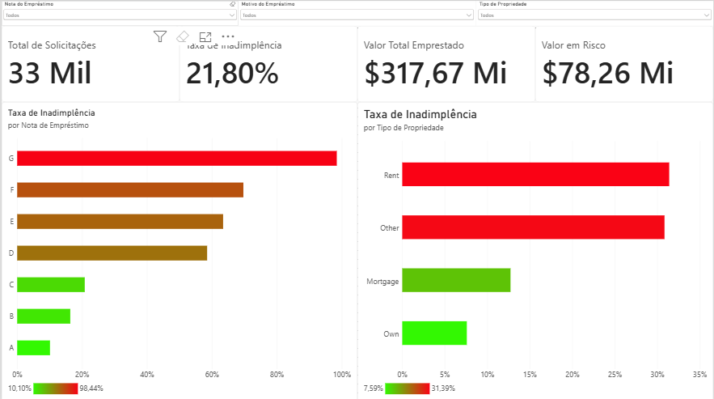
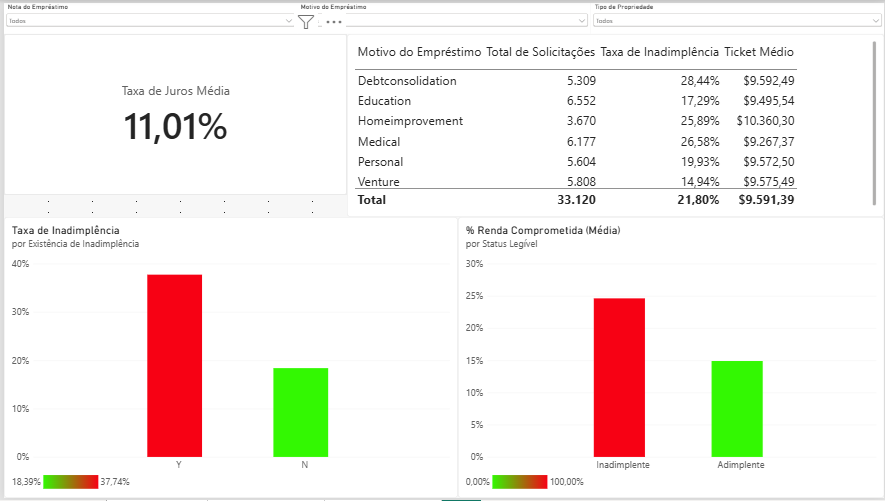
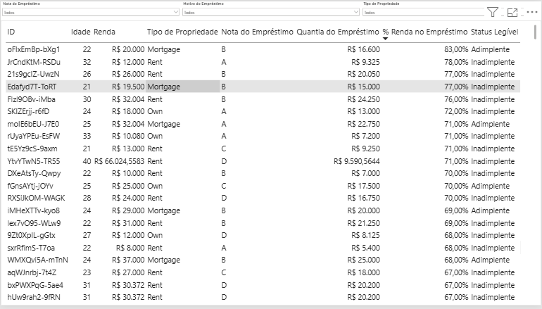

# 💳 Credit Risk Analysis — SQL, Python & Power BI

### Tratamento, modelagem e visualização de dados para análise de risco de crédito

Este projeto analisa dados de solicitantes de empréstimo para entender os fatores associados à inadimplência e construir uma solução analítica de ponta a ponta, unindo **engenharia de dados em SQL**, **análise e modelagem preditiva em Python** e um **dashboard executivo em Power BI**.

Os dados partem de um banco relacional normalizado (dados do solicitante, dados do empréstimo e histórico bancário), são consolidados em SQL, tratados e modelados em Python e chegam a um painel interativo para consulta e tomada de decisão.

---

## 🚀 Objetivos do Projeto

- Consolidar dados de solicitantes de crédito a partir de um banco relacional normalizado
- Tratar valores ausentes sem vazar informação do conjunto de teste para o modelo
- Identificar inconsistências que a camada de SQL não cobre (duplicatas e outliers de digitação)
- Explorar os fatores associados à inadimplência
- Construir um modelo preditivo de risco de crédito e discutir a escolha do limiar de decisão
- Entregar um dashboard executivo para consulta e apoio à decisão

---

## 🧱 Estrutura do Projeto

```text
credit-risk-analysis-sql-python-powerbi/
│
├── sql/
│   ├── 01_create_and_load/
│   │   ├── dados_mutuarios.sql        # schema + carga: dados do solicitante
│   │   ├── emprestimos.sql            # schema + carga: dados do empréstimo
│   │   ├── historicos_banco.sql       # schema + carga: histórico bancário
│   │   └── ids.sql                    # schema + carga: chaves de relacionamento
│   └── 02_join_tratamento.sql         # consolidação das quatro tabelas
│
├── data/
│   ├── credit_risk_consolidado.csv    # saída do SQL (numéricos ausentes mantidos como nulos)
│   └── credit_risk_tratado.csv        # base tratada para o Power BI (gerada pelo notebook)
│
├── notebooks/
│   └── analise_risco_credito.ipynb    # duplicatas, outliers, EDA, modelo e limiar de decisão
│
├── powerbi/
│   └── credit-risk-analysis-sql-python-powerbi.pbix   # dashboard executivo (3 páginas)
│
├── images/                            # prints das 3 páginas do dashboard
├── data_catalog.md                    # dicionário de dados por tabela
├── requirements.txt
└── README.md
```

---

## 🔍 As Três Camadas do Pipeline

### 1. SQL — Consolidação
As quatro tabelas normalizadas (`dados_mutuarios`, `emprestimos`, `historicos_banco`, `ids`) são unidas em `02_join_tratamento.sql`. Registros sem ID, sem categoria (moradia, motivo, nota, histórico de inadimplência) ou sem a variável-alvo (`status_emprestimo`) são descartados: **categorias e alvo nunca são imputados**. Valores numéricos ausentes são mantidos como nulos, porque a imputação precisa acontecer depois da divisão treino/teste. O resultado são 33.129 solicitações.

### 2. Python — Tratamento, Análise e Modelagem
O notebook (`analise_risco_credito.ipynb`) cobre:
- **Duplicatas:** 165 solicitações idênticas em todas as informações, com IDs diferentes, são removidas para não aparecerem ao mesmo tempo no treino e no teste.
- **Outliers de digitação:** idades acima de 80 anos (incluindo registros de 144 anos) e tempos de emprego acima de 60 anos (até 123 anos). São 9 registros removidos.
- **Imputação dentro do pipeline, ajustada só no treino:** a taxa de juros, ausente em 10% dos empréstimos, é imputada pela **mediana da nota do empréstimo**, já que a taxa varia principalmente com a nota. As demais variáveis numéricas são imputadas pela mediana, com indicadores de ausência.
- **Análise exploratória** dos fatores associados à inadimplência.
- **Modelos** (Regressão Logística e Random Forest), avaliados em um conjunto de teste nunca visto durante o treino, e **análise do limiar de decisão**.

### 3. Power BI — Dashboard Executivo
Três páginas, a partir de `data/credit_risk_tratado.csv`:
- **Visão Geral:** KPIs (total de solicitações, taxa de inadimplência, valor total emprestado, valor em risco) e os principais fatores de risco.
- **Perfil de Risco:** histórico prévio de inadimplência, percentual da renda comprometido e motivo do empréstimo.
- **Detalhamento:** tabela linha a linha para consulta pontual.

| Visão Geral | Perfil de Risco | Detalhamento |
|---|---|---|
|  |  |  |

---

## 🧠 Principais Insights

- **A nota do empréstimo é o fator mais discriminativo:** a inadimplência sobe de **10% (nota A)** a **98% (nota G)**, com um salto entre C (21%) e D (59%).
- **A situação de moradia importa muito:** quem tem casa própria quitada tem inadimplência de 7,6%, contra 31% para quem aluga, cerca de 4 vezes maior.
- **Histórico prévio de inadimplência dobra o risco:** 18% sem histórico contra 38% com histórico.
- **O percentual da renda comprometido é a variável mais importante do modelo,** à frente de moradia, nota e renda.

---

## 🤖 Resultados do Modelo

| Modelo | Acurácia | AUC |
|---|---|---|
| Regressão Logística | 86,2% | 0,86 |
| **Random Forest** | **93,0%** | **0,93** |

No limiar padrão (0,5), o Random Forest acerta quase sempre quando aponta inadimplência (precisão de 97%), mas identifica só **70% dos inadimplentes**. Como aprovar um mau pagador costuma custar mais do que recusar um bom, o limiar pode ser reduzido:

| Limiar | Inadimplentes identificados (recall) | Precisão | Solicitações recusadas |
|---|---|---|---|
| 0,50 | 70% | 97% | 16% |
| 0,40 | 73% | 92% | 17% |
| **0,30** | **76%** | **83%** | **20%** |
| 0,20 | 82% | 66% | 27% |

O limiar de 0,3 é um ponto de partida equilibrado; a escolha final depende do custo real de cada tipo de erro para a área de crédito.

---

## 🛠️ Revisão do Projeto

Esta versão revisa a primeira publicação do repositório:

| Antes | Agora |
|---|---|
| Nulos numéricos imputados pela média no SQL, usando a base inteira, inclusive os dados de teste e os outliers | Imputação dentro do pipeline do modelo, ajustada só no treino |
| Taxa de juros ausente (10% da base) preenchida com a média geral de 11,01% | Taxa imputada pela mediana da nota do empréstimo, com indicador de imputação |
| 165 solicitações duplicadas mantidas | Duplicatas removidas antes da divisão treino/teste |
| Importância das variáveis pelo critério interno do Random Forest | Importância por permutação, medida no conjunto de teste |
| Ressalva sobre o recall, sem análise do limiar | Tabela de limiares com recall, precisão e taxa de recusa |

Os resultados do modelo ficaram praticamente iguais (AUC de 0,93), o que confirma que as conclusões se sustentam com o tratamento correto.

---

## 🛠️ Tecnologias Utilizadas

- **SQL** (MySQL): schema, carga, joins e filtros de integridade
- **Python:** Pandas, NumPy, Matplotlib, Seaborn, Scikit-learn
- **Power BI:** Power Query (M), DAX, modelagem de relatório
- **Jupyter Notebook**

---

## 📖 Dicionário de Dados

Ver [`data_catalog.md`](./data_catalog.md) para a descrição de cada tabela e coluna de origem.

---

## ▶️ Como Reproduzir

**SQL:** execute os scripts de `sql/01_create_and_load/` em um servidor MySQL, um por tabela. Em seguida, rode `sql/02_join_tratamento.sql` e exporte o resultado como `data/credit_risk_consolidado.csv`.

**Python:**
```
pip install -r requirements.txt
cd notebooks
jupyter notebook analise_risco_credito.ipynb
```
O notebook gera `data/credit_risk_tratado.csv`, usado pelo dashboard.

**Power BI:** abra `powerbi/credit-risk-analysis-sql-python-powerbi.pbix` no Power BI Desktop. A fonte de dados aponta para `data/credit_risk_tratado.csv`; ajuste o caminho em **Transformar Dados → Editor do Power Query**, se necessário.

---

## ⚠️ Limitações

- O modelo é uma prova de conceito analítica, não uma solução validada para concessão de crédito real.
- Não considera variáveis macroeconômicas nem a data das solicitações; uma validação temporal (treinar no passado e testar no futuro) seria o próximo passo em um cenário real.
- A nota do empréstimo já é uma avaliação de risco feita pelo credor. O modelo complementa essa avaliação, mas parte do seu desempenho vem dela.

---

## 📬 Contato

LinkedIn: <https://linkedin.com/in/renancostaviana>
E-mail: <renan.cv@outlook.com.br>
